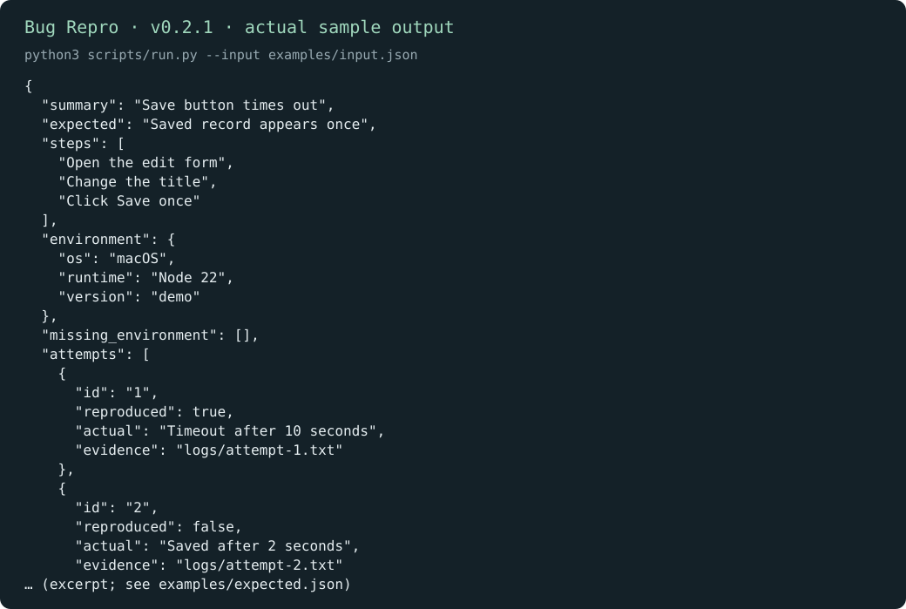
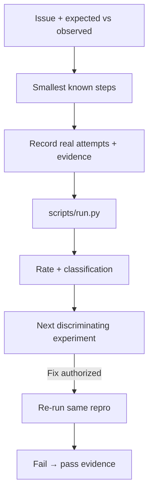

# Bug Repro

[English](README.md) · [中文](README.zh-CN.md) · **v0.2.1**

[](https://github.com/KarmenLoop/skill-bug-repro/releases/latest)
[](https://www.python.org/downloads/)
[](LICENSE)
[](skill.json)
[](SKILL.md)

**Turn a vague “it sometimes breaks” report into a record someone else can follow—with steps, environment, and attempt evidence.**

Bug reports collapse when steps, environment, and attempt outcomes live in three different chats. **Bug Repro** is a portable agent skill plus a local Python helper that structures observations into numbered steps, environment fields, per-attempt evidence, and a reproduction rate / classification (for example intermittent at 0.5). The helper **does not open the application** or run the repro itself—you or your tools supply each attempt’s actual result.

Built and maintained by [KarmenLoop](https://github.com/KarmenLoop) / [KARMENLOOP](https://karmenloop.com). Current release: **[v0.2.1](https://github.com/KarmenLoop/skill-bug-repro/releases/tag/v0.2.1)**. License: **MIT**.



*Actual local output from v0.2.1, rendered as an image. [Complete result](examples/expected.json) · [Image provenance](docs/images/provenance.json).*

[Download v0.2.1](https://github.com/KarmenLoop/skill-bug-repro/releases/tag/v0.2.1) · [Tutorial](docs/tutorial.en.md) · [中文教程](docs/tutorial.zh-CN.md) · [Input contract](docs/INPUT.md)

---

## Why this exists

Agents are eager to invent missing steps and eager to declare root cause. This package pushes the opposite discipline: preserve the exact input and error, keep a reported incident distinct from a reproduction you actually ran, and never invent failed attempts to make a report look complete.

---

## Snapshot

| | |
|---|---|
| **What you install** | Portable skill (`SKILL.md`, docs, examples) + local helper under `scripts/` |
| **Package name** | `karmen-bug-repro` |
| **Version** | **0.2.1** (`skill.json`, release tag, `--version`) |
| **Runtime** | Python **3.9+**, standard library only |
| **Network** | Helper: **offline** (`"network": false` in `skill.json`) |
| **Entry** | `python3 scripts/run.py --input …` · optional `python3 install.py --host agents` |
| **Sample artifact** | [examples/input.json](examples/input.json) → [examples/expected.json](examples/expected.json) |
| **License** | [MIT](LICENSE) — keep [NOTICE.md](NOTICE.md) with redistributed copies |

---

## Is / Is not

| Is | Is not |
|---|---|
| Structured repro record from supplied attempts | Automatic UI driver that opens the app |
| Reproduction rate and classification (e.g. intermittent) | Root-cause proof or debugger |
| Portable skill + stdlib Python helper | Issue tracker replacement |
| Evidence paths attached per attempt | Permission to change production data |
| Honest zero-failure outcome when nothing reproduced | Fabricated attempts for completeness |

---

## How it works

1. **Method layer** — collect observed failure, expected result, environment, and smallest known steps; define discriminating experiments; if a fix is requested, show the same reproduction flipping from fail to pass.
2. **Helper** — assemble evidence into JSON (`summary`, `steps`, `environment`, `attempts`, `reproduction_rate`, `classification`). It does not execute commands.

### Flow



### Sample (v0.2.1)

Two attempts, one reproduction: `classification` is **intermittent**, `reproduction_rate` is **0.5** (save-button timeout vs later success). See [examples/expected.json](examples/expected.json).

---

## Quickstart

### A. Run the helper (no agent host required)

1. Download `karmen-bug-repro-v0.2.1.zip` and its `.sha256` from the [v0.2.1 release](https://github.com/KarmenLoop/skill-bug-repro/releases/tag/v0.2.1).
2. Verify the hash, then extract.
3. In the extracted directory, with Python 3.9+:

```sh
python3 scripts/run.py --version
python3 scripts/run.py --input examples/input.json
```

Expected version string: `karmen-bug-repro 0.2.1`. JSON lands on stdout. Use `--output new-result.json` to keep a copy without overwriting existing files. Pipe mode: `--input -`.

### B. Install the portable skill

For hosts that read `~/.agents/skills` (or a project `.agents/skills`):

```sh
python3 install.py --host agents
```

The installer **refuses an existing destination**—use a fresh path or remove the old copy first. Host discovery and invocation vary; see [docs/tutorial.en.md](docs/tutorial.en.md). You can keep using the helper directly without any AI host.

### Use it with your own work

- Use one stable ID per attempt.
- Fill OS, runtime, and application version; attach a real evidence path or reference.
- Prefer the project’s documented test command and isolated fixtures over production data.
- A zero failure count means the recorded attempts did not reproduce the issue—say so.

Read [docs/INPUT.md](docs/INPUT.md) before preparing new input. The helper needs no model account, API key, or network connection. An AI host has its own data and permission settings; this skill adds no authority to send, purchase, publish, or change access.

---

## Documentation map

| Doc | Use it when you need… |
|---|---|
| [Tutorial (EN)](docs/tutorial.en.md) · [中文](docs/tutorial.zh-CN.md) | Download, install, practice, upgrade, remove |
| [INPUT.md](docs/INPUT.md) · [input.zh-CN.md](docs/input.zh-CN.md) | Field contract |
| [COMPATIBILITY.md](docs/COMPATIBILITY.md) | Host / runtime notes |
| [VALIDATION.md](docs/VALIDATION.md) | What checks cover |
| [SOURCES.md](docs/SOURCES.md) | Provenance pointers |
| [CHANGELOG.md](CHANGELOG.md) | History through 0.2.1 |
| [SECURITY.md](SECURITY.md) / [SUPPORT.md](SUPPORT.md) / [CONTRIBUTING.md](CONTRIBUTING.md) | Ops |

---

## FAQ

### What is Bug Repro in one sentence?

A MIT-licensed agent skill and offline helper that turns supplied bug observations into a followable reproduction record with rate and classification.

### Does the helper reproduce the bug?

No. Attempt results are supplied by you or your tools. The helper organizes evidence; it does not open the application.

### Can it invent missing steps to complete a report?

The skill forbids inventing failed attempts. Missing environment fields are listed; they are not invented.

### Where does output go?

JSON to stdout by default, or `--output` to a new file. Existing files are preserved.

### Is a fixture result proof that production failed?

No. Keep a reported incident distinct from a reproduction you actually ran.

### Soft discoverability

Useful phrases: **bug reproduction template for agents**, **intermittent failure classification**, **repro rate from attempt evidence**, **offline bug report skill**. Avoid stuffing; the substance is in the skill and helper, not keyword density.

---

## License and contact

[MIT](LICENSE). Keep the license and [NOTICE.md](NOTICE.md) with redistributed copies.

Maintainer: [KarmenLoop](https://github.com/KarmenLoop) · Site: [karmenloop.com](https://karmenloop.com)

Issues: [GitHub Issues](https://github.com/KarmenLoop/skill-bug-repro/issues) · Support policy: [SUPPORT.md](SUPPORT.md). Prefer synthetic data when filing example bugs.
