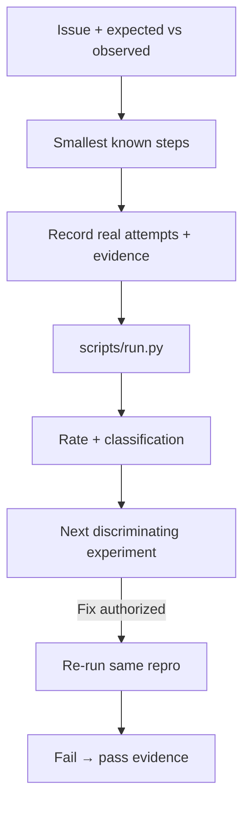

# 问题复现记录 · Bug Repro

[English](README.md) · [中文](README.zh-CN.md) · **v0.2.1**

[](https://github.com/KarmenLoop/skill-bug-repro/releases/latest)
[](https://www.python.org/downloads/)
[](LICENSE)
[](skill.json)
[](SKILL.md)

**把“偶尔会坏”变成别人能照着查的记录：步骤、环境、每次结果与证据放在一起。**

复现步骤、环境与尝试结果散落在不同对话里时，问题单就会塌掉。**问题复现记录**是可移植的 Agent Skill，外加本地 Python 助手：把观察整理成编号步骤、环境字段、每次尝试的证据，以及复现率与分类（例如 intermittent、0.5）。助手**不会打开应用或替你复现**——每次实际结果由你或工具提供。

由 [KarmenLoop](https://github.com/KarmenLoop) / [KARMENLOOP](https://karmenloop.com) 维护。当前发行版：**[v0.2.1](https://github.com/KarmenLoop/skill-bug-repro/releases/tag/v0.2.1)**。许可：**MIT**。


*图片来自 v0.2.1 的真实本地输出（英文键名）。[完整结果](examples/expected.json) · [图片来源记录](docs/images/provenance.json)。*

[下载 v0.2.1](https://github.com/KarmenLoop/skill-bug-repro/releases/tag/v0.2.1) · [中文教程](docs/tutorial.zh-CN.md) · [English tutorial](docs/tutorial.en.md) · [输入契约](docs/input.zh-CN.md)

---

## 为什么需要它

代理很容易补全缺失步骤，也很容易直接下根因结论。本包推动相反的纪律：保留精确输入与错误，把“别人报告的现象”和“你实际跑过的复现”分开，绝不编造失败尝试来让报告显得完整。

---

## 一览

| | |
|---|---|
| **安装内容** | 可移植 Skill（`SKILL.md`、文档、样例）+ `scripts/` 下本地助手 |
| **包名** | `karmen-bug-repro` |
| **版本** | **0.2.1**（`skill.json`、发行标签、`--version`） |
| **运行时** | Python **3.9+**，仅标准库 |
| **网络** | 助手：**离线**（`skill.json` 中 `"network": false`） |
| **入口** | `python3 scripts/run.py --input …` · 可选 `python3 install.py --host agents` |
| **样例产物** | [examples/input.json](examples/input.json) → [examples/expected.json](examples/expected.json) |
| **许可** | [MIT](LICENSE) — 再分发时保留 [NOTICE.md](NOTICE.md) |

---

## 是 / 不是

| Is | Is not |
|---|---|
| 由你提供的尝试记录整理成结构化复现单 | 自动打开应用的 UI 驱动 |
| 复现率与分类（如 intermittent） | 根因证明或调试器 |
| 可移植 Skill + 标准库 Python 助手 | 缺陷跟踪系统替代品 |
| 每次尝试可挂证据路径 | 改生产数据的授权 |
| 未复现时诚实给出零失败结果 | 为显得完整而编造的尝试 |

---

## 如何工作

1. **方法层** — 收集观察到的失败、期望结果、环境与已知最小步骤；设计可区分的实验；若要求修复，展示同一复现从失败变为成功。
2. **助手** — 把证据组装成 JSON（`summary`、`steps`、`environment`、`attempts`、`reproduction_rate`、`classification`）。它不执行命令。

### 流程



### 样例（v0.2.1）

两次尝试、一次复现：`classification` 为 **intermittent**，`reproduction_rate` 为 **0.5**（保存按钮超时 vs 稍后成功）。详见 [examples/expected.json](examples/expected.json)。

---

## 快速开始

### A. 直接跑助手（不需要 AI 宿主）

1. 从 [v0.2.1 发行页](https://github.com/KarmenLoop/skill-bug-repro/releases/tag/v0.2.1) 下载 `karmen-bug-repro-v0.2.1.zip` 与对应 `.sha256`。
2. 核对哈希后解压。
3. 在解压目录中使用 Python 3.9+：

```sh
python3 scripts/run.py --version
python3 scripts/run.py --input examples/input.json
```

期望版本字符串：`karmen-bug-repro 0.2.1`。JSON 默认输出到 stdout。用 `--output new-result.json` 落盘且不覆盖已有文件。管道：`--input -`。

### B. 安装可移植 Skill

若宿主读取 `~/.agents/skills`（或项目内 `.agents/skills`）：

```sh
python3 install.py --host agents
```

安装器**拒绝已存在的目标目录**——请换新路径或先移除旧副本。宿主发现与调用方式因环境而异；见 [docs/tutorial.zh-CN.md](docs/tutorial.zh-CN.md)。也可以完全不装宿主，只跑助手。

### 用于你自己的工作

- 每次尝试使用稳定唯一 ID。
- 填写 OS、运行时与应用版本；挂上真实证据路径或引用。
- 优先用项目文档中的测试命令与隔离夹具，而不是动生产数据。
- 失败次数为零表示已记录的尝试未能复现——如实写明。

准备新输入前请阅读 [docs/input.zh-CN.md](docs/input.zh-CN.md) / [docs/INPUT.md](docs/INPUT.md)。助手不需要模型账号、API 密钥或网络。AI 宿主有自己的数据与权限设定；本 Skill **不**额外授予发送、购买、发布或改权限的权力。

---

## 文档地图

| 文档 | 用途 |
|---|---|
| [中文教程](docs/tutorial.zh-CN.md) · [English](docs/tutorial.en.md) | 下载、安装、练习、升级、移除 |
| [input.zh-CN.md](docs/input.zh-CN.md) · [INPUT.md](docs/INPUT.md) | 字段契约 |
| [COMPATIBILITY.md](docs/COMPATIBILITY.md) | 宿主 / 运行时说明 |
| [VALIDATION.md](docs/VALIDATION.md) | 校验覆盖范围 |
| [SOURCES.md](docs/SOURCES.md) | 来源与溯源 |
| [CHANGELOG.md](CHANGELOG.md) | 至 0.2.1 的历史 |
| [SECURITY.md](SECURITY.md) / [SUPPORT.md](SUPPORT.md) / [CONTRIBUTING.md](CONTRIBUTING.md) | 运维 |

---

## 常见问题

### 一句话：问题复现记录是什么？

MIT 许可的 Agent Skill 与离线助手：把你提供的缺陷观察整理成可跟进的复现记录，并给出复现率与分类。

### 助手会替我复现吗？

不会。尝试结果由你或工具提供。助手只整理证据，不打开应用。

### 可以编造缺失步骤让报告完整吗？

Skill 禁止编造失败尝试。缺失的环境字段会列出，而不是捏造。

### 结果写到哪里？

默认 stdout JSON，或 `--output` 写入新文件；已有文件不覆盖。

### 样例结果能证明生产坏了吗？

不能。要把“报告的现象”和“你实际跑过的复现”分开。

### 温和可发现性

可用检索说法：**面向代理的缺陷复现模板**、**间歇性故障分类**、**由尝试证据得出的复现率**、**离线缺陷报告 Skill**。 避免堆砌；实质在 Skill 与助手里，不在关键词密度。

---

## 许可与联系

[MIT](LICENSE)。再分发时请保留许可证与 [NOTICE.md](NOTICE.md)。

维护者：[KarmenLoop](https://github.com/KarmenLoop) · 站点：[karmenloop.com](https://karmenloop.com)

问题反馈：[GitHub Issues](https://github.com/KarmenLoop/skill-bug-repro/issues) · 支持政策：[SUPPORT.md](SUPPORT.md)。提交样例相关问题时请优先使用合成数据。
